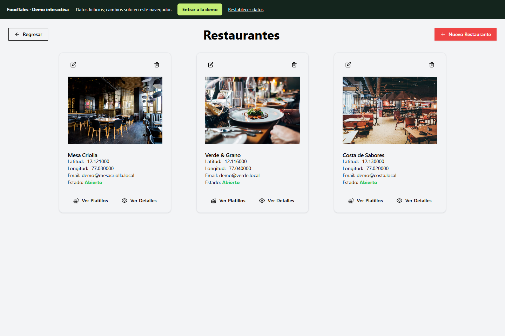

# FoodTales

Red social gastronómica que reúne restaurantes, platos, publicaciones y reseñas.

**Edición de portafolio de Ronal Condor · proyecto académico colaborativo.**

**Mi participación:** desarrollo frontend con React y TypeScript, y contribuciones al backend Java/Spring Boot: entidades, autenticación, lógica de servicios y pruebas.

[Código original del backend](https://github.com/CS2031-DBP/proyecto-backend-foodtales) · [Mis commits originales](https://github.com/CS2031-DBP/proyecto-backend-foodtales/commits/main/?author=ronaljcb) · [Mi participación y arquitectura](docs/CONTRIBUTIONS.md)

[](https://foodtales-hazel.vercel.app) 



**[Abrir demo interactiva](https://foodtales-hazel.vercel.app)**

## Explorar

Restaurantes y platos; creación, edición y eliminación de publicaciones; comentarios, calificaciones y perfil.

La demo funciona sin las cuentas ni los servidores antiguos de AWS. Los datos son **ficticios**, las modificaciones se guardan en **localStorage del navegador** y pueden restablecerse desde la barra superior. No hay base de datos compartida, autenticación de producción, pagos reales ni recuperación de registros históricos. No introduzcas contraseñas reales o información personal.

Pulsa **Entrar a la demo**. Acceso manual opcional: `demo@foodtales.local` / `Demo123!`.

## Tecnología

React · TypeScript · Vite · Tailwind · Java · Spring Boot · PostgreSQL.

## Ejecutar localmente

Requiere Node.js 22 y npm.

```sh
npm install
npm run dev
```

El comando raíz delega la aplicación en `frontend/`.

```sh
npm run build
```

## Despliegue

Importa este repositorio en Vercel y configura **Root Directory** como `frontend`. La configuración `vercel.json` de esa carpeta define el despliegue. El modo demo está habilitado de forma predeterminada.

## Arquitectura y recuperación

Consulta [la migración desde AWS](docs/MIGRATION.md), [la procedencia y revisiones originales](docs/PROVENANCE.md) y [las comprobaciones realizadas](docs/VERIFICATION.md).

Los créditos del equipo y la documentación académica original se conservan en los archivos originales. Esta edición organiza y adapta ese trabajo; no atribuye a una sola persona la autoría de todo el proyecto.
