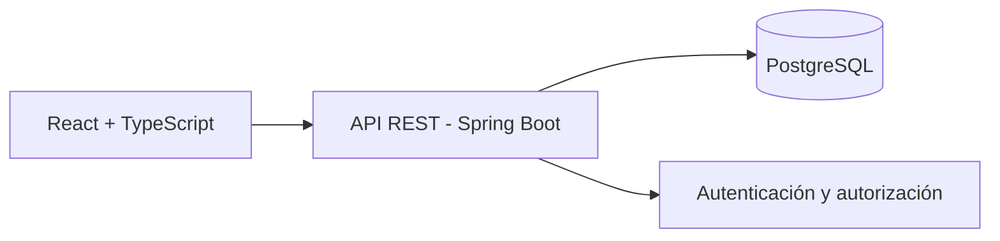

# Mi participación en FoodTales

FoodTales es un proyecto académico colaborativo. Esta edición de portafolio reúne el frontend y el backend en un monorepositorio; la autoría del equipo se mantiene en la documentación original.

## Trabajo de Ronal Condor

- Desarrollo frontend con React y TypeScript: interfaces de acceso, registro y navegación de la aplicación.
- Contribuciones al backend con Java y Spring Boot: entidades, lógica de servicios, autenticación y manejo de excepciones.
- Implementación de pruebas de entidades y servicios.

## Evidencia del historial original

| Evidencia | Enlace |
| :--- | :--- |
| Historial personal del backend | [Commits de ronaljcb](https://github.com/CS2031-DBP/proyecto-backend-foodtales/commits/main/?author=ronaljcb) |
| Lógica de usuario, comentarios y autenticación | [Commit 2709b31](https://github.com/CS2031-DBP/proyecto-backend-foodtales/commit/2709b316ca671fc4c8d1e744fbc257f35aa7df86) |
| Pruebas de la entidad Food | [Commit c215367](https://github.com/CS2031-DBP/proyecto-backend-foodtales/commit/c2153673121a1b024a74cd25f17bfe3e58bdfa81) |
| Ramas de trabajo del equipo | [Branches](https://github.com/CS2031-DBP/proyecto-backend-foodtales/branches) |

El frontend original se encuentra en [CS2031-DBP/proyecto-frontend-web-foodtales](https://github.com/CS2031-DBP/proyecto-frontend-web-foodtales), un repositorio privado. Se verificaron aportes de mi cuenta, pero su consulta requiere acceso a la organización. Las ramas enlazadas corresponden al equipo y no se atribuyen todas a una sola persona.

## Arquitectura del proyecto

El diagrama describe el sistema original. En la [demo de portafolio](https://foodtales-hazel.vercel.app), un adaptador local sustituye las llamadas al backend y guarda datos ficticios en el navegador. El backend Java y PostgreSQL no se ejecutan en ese despliegue.

Consulta también [la migración](MIGRATION.md), [la procedencia](PROVENANCE.md) y [la verificación](VERIFICATION.md).
